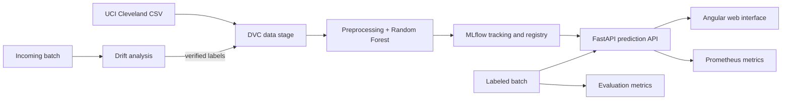

# Heart Disease MLOps

Mini-projet MLOps de classification binaire à partir du jeu Cleveland Heart Disease de l'UCI. La cible `num` est convertie en `target` : `0` signifie absence de maladie et `1` présence d'au moins une maladie.

> **Prototype pédagogique uniquement.** Ce projet n'est ni un outil de diagnostic ni un dispositif d'aide à la décision médicale. Utilise uniquement des profils fictifs.

L'interface affiche cet avertissement sur toutes ses pages. Ne saisis et ne téléverse aucune donnée personnelle ou de santé réelle : le formulaire et l'évaluation sont réservés à des données fictives de démonstration.

## Architecture



## Structure

```text
frontend/                  Angular UI: demo, evaluation, monitoring, research checklist
frontend/src/app/           Routes, pages, and FastAPI client
frontend/public/             Dashboard hero image
app/main.py                 FastAPI: OIDC-protected prediction, evaluation, research readiness, Prometheus
app/oidc.py                  Keycloak access-token signature and claims validation
keycloak/                    Local OIDC realm and frontend client configuration
src/features.py             Patient schema, preprocessing, promotion metrics
src/generate_data.py        UCI loader, binary target mapping, drift batch
src/train.py                Training, champion comparison, MLflow registration
src/drift.py                KS and chi-square drift analysis
data/                        DVC-managed input data
tests/                       API, data, drift, and model-metric tests
dvc.yaml / dvc.lock          Reproducible data and training pipeline
docker-compose.yml           Angular, Keycloak, MLflow, FastAPI, Prometheus services
```

## Prerequisites

- Python 3.10+ and Git.
- Node.js 22.12+ and npm for Angular 21.
- Docker Desktop is needed for the one-command local application.
- UCI data download needs internet access; alternatively supply the Cleveland source file with `--source`.

## Run locally on Windows

> **Important:** run every command from the project root `C:\Users\Hazar\Desktop\MLOPS-Project\mlops-pipeline` (the folder containing this README and `docker-compose.yml`), not from its parent `MLOPS-Project`.

Open PowerShell there with:

```powershell
cd C:\Users\Hazar\Desktop\MLOPS-Project\mlops-pipeline
```

Start the patient portal without configuring Keycloak:

```powershell
docker compose up -d --build
```

Open `http://127.0.0.1:4200` and choose **Créer un compte**. Public sign-up creates patient accounts only. The optional Keycloak service is not needed for this flow.

Install Python dependencies and activate the virtual environment:

```powershell
cd C:\Users\Hazar\Desktop\MLOPS-Project\mlops-pipeline
py -3.11 -m venv .venv
.\.venv\Scripts\Activate.ps1
python -m pip install -r requirements.txt
```

The equivalent setup script is ` .\scripts\setup.ps1`.

Prepare data and train if the model has not already been registered:

```powershell
python src/generate_data.py
# Or use an existing file: python src/generate_data.py --source C:\path\processed.cleveland.data
```

Keycloak remains available only for the older role-managed demonstration flow. It is not required for patient sign-up. To start it explicitly, set an administrator password and enable its Docker profile:

```powershell
$env:KEYCLOAK_ADMIN_PASSWORD = Read-Host "Keycloak admin password"
docker compose --profile identity-admin up -d keycloak
```

Open `http://127.0.0.1:8080`, sign in to the Keycloak administration console with username `admin` and the password you just entered, select the `heart-demo` realm, then create a user under **Users**. Set a password under **Credentials** and turn off **Temporary** for this local demo account. This optional OIDC path is separate from the local patient sign-in screen.

Assign the user exactly one portal role (`patient`, `doctor`, `admin`, or `researcher`) under **Role mapping**. For example, a patient account gets `patient`, while a clinician account gets `doctor`. The application derives its workspace from the signed-in account; users cannot switch roles in authenticated mode.

For checklist editing, assign the `research-editor` realm role to the account: open **Realm roles** and create `research-viewer`, `research-editor`, and `research-admin` if they are not already present, then open the user, select **Role mapping → Assign role → Filter by realm roles**, and assign `research-editor`. Sign out and sign in again so the role is included in the access token. Editors and admins can update checklist records; authenticated users without these roles can only view them. This is a local project role, not a clinical authorization.

In one PowerShell window, start MLflow:

```powershell
python -m mlflow server --host 127.0.0.1 --port 5000 --workers 1 --backend-store-uri sqlite:///mlflow.db --default-artifact-root ./mlruns
```

In another window, run the pipeline:

```powershell
cd C:\Users\Hazar\Desktop\MLOPS-Project\mlops-pipeline
.\.venv\Scripts\Activate.ps1
$env:MLFLOW_TRACKING_URI = "http://127.0.0.1:5000"
dvc repro
```

Alternatively, after starting MLflow, run ` .\scripts\train.ps1` from the project root.

Start the API in another PowerShell window and leave it open:

```powershell
cd C:\Users\Hazar\Desktop\MLOPS-Project\mlops-pipeline
.\.venv\Scripts\Activate.ps1
$env:MLFLOW_TRACKING_URI = "http://127.0.0.1:5000"
python -m uvicorn app.main:app --host 127.0.0.1 --port 8001
```

For direct local API/UI runs, set `$env:AUTH_MODE = "local"` before starting the API. Then start the Angular UI in another PowerShell window:

```powershell
cd C:\Users\Hazar\Desktop\MLOPS-Project\mlops-pipeline\frontend
npm.cmd ci
npm.cmd start
```

Open `http://127.0.0.1:4200`. The interface provides a fictitious profile simulation, experimental model evaluation, service monitoring, and a research-readiness checklist. FastAPI is available at `http://127.0.0.1:8001/docs` and MLflow at `http://127.0.0.1:5000`.

The patient portal uses its own local sign-up and sign-in endpoints. Account passwords are stored as salted hashes and sessions expire after 12 hours. Keep the API bound to `127.0.0.1`; this local authentication is not suitable for an Internet-facing service.

The **Préparation recherche** page reads `GET /research/readiness` and saves updates through the role-protected `PUT /research/readiness/{item_id}` endpoint. Each planning item has an editable status, owner, due date, and project note; changes are persisted to a local SQLite database and a history records the account, timestamp, and changed field names. In Docker Compose the database is stored in the persistent `mlflow-data` volume. Do not put patient or other sensitive health information in project notes. A status marked “Documenté” is a team-declared project state, not independent verification. Checklist entries are project-management records only, not evidence of approval, regulatory advice, or permission for clinical use.

To run the containerized patient portal, no Keycloak administrator password is needed:

```powershell
docker compose up -d --build
```

Open `http://127.0.0.1:4200` and create a patient account in the interface. The optional Keycloak realm/client settings remain in `keycloak/heart-demo-realm.json` for administrative experiments. The portal uses local HTTP and SQLite for demonstration only; do not expose it to the Internet or enter real patient information.

## Patient and clinician portal foundation

The portal now has separate patient, clinician, administrator, and research workspaces. Patients can request or cancel a synthetic appointment and manage optional contact/sharing preferences. Clinicians can confirm or decline appointment requests. Clinicians register their own appointment profile at first sign-in. Administrators can read the access/action audit feed; the admin workspace does not expose appointment or clinical content. Research simulation, evaluation, and monitoring routes are role-gated separately from patient and clinician workflows.

The API stores patient accounts, sessions, appointments, consent choices, and audit events in `PORTAL_DB` (the persistent `mlflow-data` volume in Compose). Public sign-up always assigns the patient role. To grant a registered account clinician access, an administrator with Docker access runs `docker compose exec api python -m app.account_admin --email medecin@example.com --role doctor`, then the user signs out and back in. Doctor, administrator, and research access cannot be self-assigned through public sign-up.

This is a local software foundation, not a production medical service. Compose still uses development-mode Keycloak, local HTTP, and SQLite. Do not enter real patient information. Patient record storage, clinical notes, encrypted document exchange, secure messaging, appointment notifications, production key management, immutable audit infrastructure, and clinical/regulatory validation are not implemented. The model remains isolated for research and must not be used to guide care.

## Model and monitoring

The training pipeline uses stratified cross-validation on the training split and calibrates the decision threshold from out-of-fold training predictions. It then evaluates that fixed threshold on a separate stratified holdout. The report records cross-validation mean and variability, holdout metrics, exploratory age/sex subgroup summaries, and a SHA-256 hash of the data. MLflow stores the validation report and a model card with intended use and limitations. A candidate is promoted only if it reaches the configured recall target on the holdout and improves precision over the current champion (or if no champion exists and it reaches the recall target). The threshold and data hash are attached to the registered model version.

These steps improve reproducibility and reduce evaluation leakage; they do not establish clinical validity. The dataset is small and historical, subgroup results are descriptive only, and the holdout is not independent external validation. This model is for education and research on the UCI Cleveland dataset only. Do not use it for diagnosis, screening, treatment, or clinical decisions, and do not enter real patient data.

Generate and inspect a synthetic drift sample:

```powershell
python src/generate_data.py --drift
python src/drift.py --current data/incoming/drifted.csv
```

The drift report uses Kolmogorov–Smirnov for numeric fields and chi-square for categorical fields. Synthetic unlabeled data is for demonstration and cannot be used for retraining.

To avoid the “script not recognized” error, confirm `Get-Location` ends in `MLOPS-Project\mlops-pipeline` and that `Test-Path .\scripts\setup.ps1` returns `True`. PowerShell scripts require the ` .\` prefix; Docker Compose commands also must run in the project root where `docker-compose.yml` is located. If the API connection is refused, first check `docker compose ps` and `docker compose logs api` from that same directory. Docker Desktop must be running.

To evaluate a verified labeled CSV, use the Angular **Qualité du modèle** page or call `POST /evaluate`. Input columns are the 13 Cleveland features plus `target` (0 or 1).

- Prometheus metrics: `http://127.0.0.1:8001/metrics/`.
- MLflow UI: `http://127.0.0.1:5000`.
- Tests: `python -m pytest -q`.
- Angular production build: from `frontend`, run `npm.cmd run build`.
- Docker Compose: `docker compose up -d --build`; Angular is on port 4200, API on 8001, MLflow on 5000, Prometheus on 9090.

To retrain only after preparing a verified labeled batch, run
`dvc repro retraining/dvc.yaml:retrain`. This optional stage is kept separate so the
normal `dvc repro` pipeline does not require `data/incoming/heart_labeled.csv`.
"# heartlab-mlops" 
